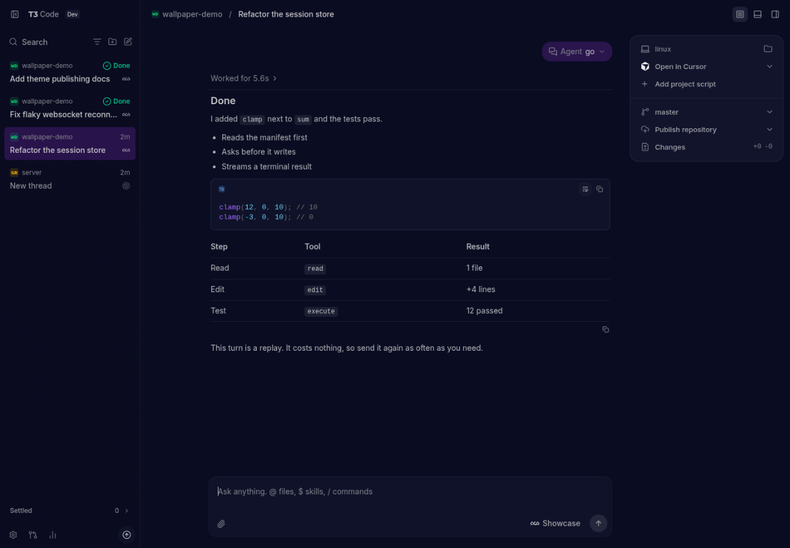
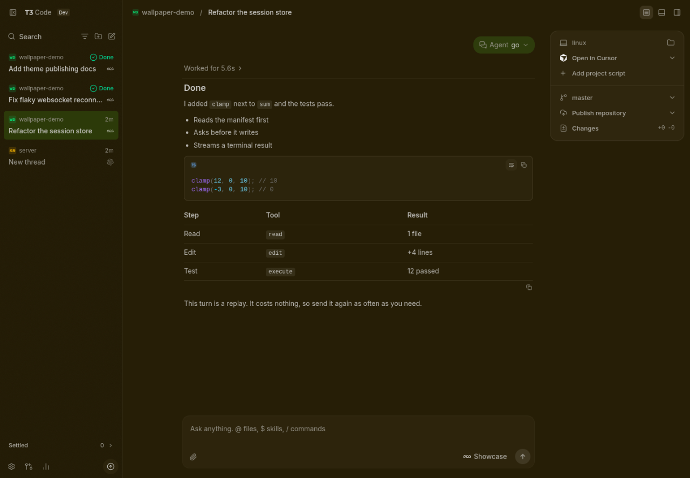
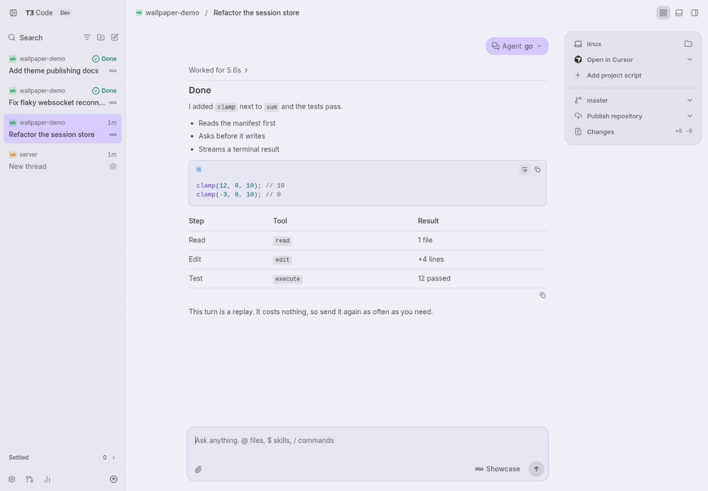

# t3code-wal

Theme [T3 Code](https://github.com/pingdotgg/t3code) from your wallpaper with [pywal](https://github.com/eylles/pywal16).

| Dark purple wallpaper         | Green wallpaper               | `wal -l`                     |
| ----------------------------- | ----------------------------- | ---------------------------- |
|     |      |      |

When your wallpaper changes, open T3 Code windows repaint without a reload.

## Install

It's one POSIX shell script. It needs `jq` and `awk`.

```sh
curl -fsSL https://raw.githubusercontent.com/sabrehagen/t3code-wal/main/t3code-wal -o ~/.local/bin/t3code-wal
chmod +x ~/.local/bin/t3code-wal
```

Or copy `t3code-wal` from a clone to anywhere on your `PATH`.

## Use

Run it after `wal`, wherever you already reload your other themes:

```sh
wal -i ~/wallpapers && t3code-wal
```

Or let pywal run it:

```sh
wal -i ~/wallpapers -o t3code-wal
```

Then select it once, in T3 Code's **Settings → Appearance**, under **Wal**. From then on it follows your wallpaper. Alternatively, `t3 theme set wal` switches every connected client.

### Options

| Flag           | Default                                                      |                                           |
| -------------- | ------------------------------------------------------------ | ----------------------------------------- |
| `--colors`     | `~/.cache/wal/colors.json`, honoring pywal's environment     | The pywal palette to read                 |
| `--themes-dir` | `~/.t3/userdata/themes`, or under `$T3CODE_HOME` if it's set | The T3 Code server's themes directory     |
| `--stdout`     |                                                              | Print the theme instead of publishing it  |

## Where it works

T3 Code themes belong to the machine running the server. Run `t3code-wal` on that machine. Themes reach the desktop app's main local environment and any browser using the web app that server serves.

app.t3.codes, additional connections, and the mobile app don't use published themes.

## How the colors are chosen

T3 Code has 61 color roles. pywal has 16 slots, and they carry less than that suggests:

- **Slots are not hues.** pywal sorts colors from your wallpaper into slots, so `color1` isn't red. On a purple wallpaper, `color1` through `color6` are six purples.
- **Slots repeat.** `color9` through `color14` are usually `color1` through `color6` again.
- **Slots aren't contrast-checked.** `color8` can sit below 2:1 on the background.

Mapping roles straight onto slots would make errors purple and placeholders unreadable. So each role comes from one of three sources:

| Source               | Roles                                                  | How                                                                                                                                                                                                       |
| -------------------- | ------------------------------------------------------ | --------------------------------------------------------------------------------------------------------------------------------------------------------------------------------------------------------- |
| **A ladder**         | Canvas, surfaces, borders, inputs, hover, sidebar rows | Steps away from `special.background` that keep its hue. The step sizes follow [vscode-wal](https://github.com/sabrehagen/vscode-wal): menus 10, hover 16, borders 28. Light wallpapers step downward.    |
| **The palette**      | Accent, buttons, focus, text, terminal foreground and cursor | `color5` is the accent, unless it's gray or its hue would read as an error or warning. Then the next suitable slot is used. `color12` is the focus ring.                                             |
| **Fixed meanings**   | Error, warning, search match                           | T3 Code's own red and amber, leaning at most 10° toward your accent. They fit the wallpaper and still mean what they mean.                                                                               |

Every color that has to be read is then checked. If it falls short (7:1 for body text, 4.5:1 for other text, 3:1 for indicators), only its lightness moves, so it keeps its hue. A color that already passes is left exactly as pywal gave it.

The theme also includes T3 Code's `canvas` and `accent` seeds, so a role added in a later T3 Code version is derived from your wallpaper rather than falling back to a stock color.

## What isn't themed

These stay T3 Code's native colors whatever your wallpaper is, because no theme role reaches them:

- Success, info, and diff colors, so a passing check stays green and a deletion stays red.
- Syntax highlighting.
- Thread status colors in the sidebar.

The terminal's 16 ANSI colors are also outside the theme, but you can have them too. T3 Code's terminal applies pywal's escape sequences, so add this to your shell's startup file, as pywal's own docs suggest:

```sh
cat ~/.cache/wal/sequences 2>/dev/null
```

## Limits

- **All-red or all-orange wallpapers.** If every color in the palette is near an error or warning hue, the accent keeps the wallpaper's color and sits close to that status color. Errors remain distinguishable by their icon and tinted surface, but less so by hue alone.
- **Mid-tone backgrounds.** With a custom `wal -b` near mid-gray, no single text color can reach 4.5:1 on both a lighter and a darker row, so sidebar text bottoms out near 4:1.

## Development

```sh
sh tests/run.sh
```

`tests/palettes.json` holds real pywal output and edge cases. Add a palette there if you find a wallpaper that themes badly.
