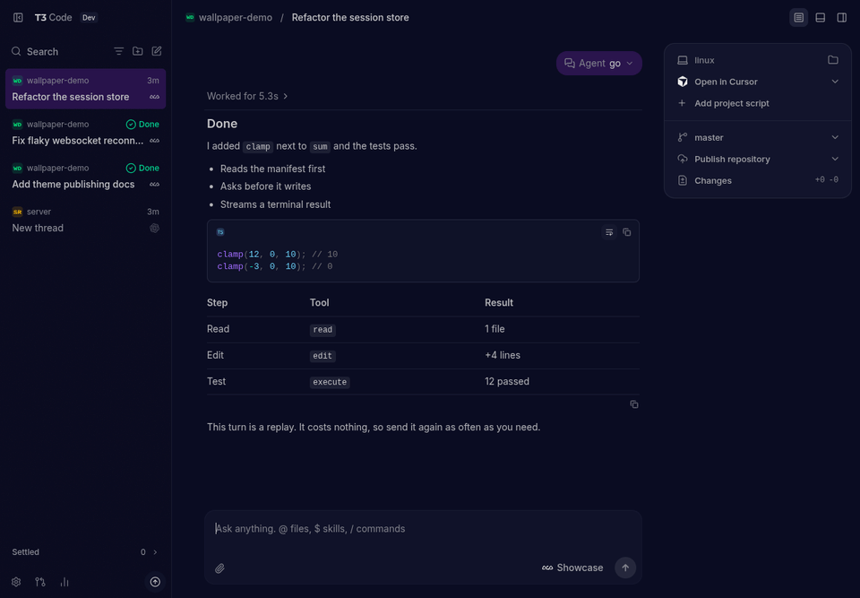

# t3code-wal

Theme [T3 Code](https://github.com/pingdotgg/t3code) from your wallpaper with [pywal](https://github.com/eylles/pywal16).



## Install

You need pywal, `jq` and `awk`. t3code-wal itself is one POSIX shell script.

```sh
mkdir -p ~/.local/bin
curl -fsSL https://raw.githubusercontent.com/sabrehagen/t3code-wal/main/t3code-wal -o ~/.local/bin/t3code-wal
chmod +x ~/.local/bin/t3code-wal
```

## Use

1. Run it after `wal`:

   ```sh
   wal -i ~/wallpapers && t3code-wal
   ```

   Or let pywal run it:

   ```sh
   wal -i ~/wallpapers -o t3code-wal
   ```

2. Select the theme once, under **Wal** in T3 Code's **Settings → Appearance**. Or run `t3 theme set wal` to switch every connected client.

From then on, each wallpaper change repaints open T3 Code windows without a reload.

If you start your server with `t3 serve --base-dir`, see [A server with its own base directory](#a-server-with-its-own-base-directory).

## Options

| Flag               | What it does                                                             | Default                                                  |
| ------------------ | ------------------------------------------------------------------------ | -------------------------------------------------------- |
| `--colors FILE`    | The pywal palette to read                                                | `~/.cache/wal/colors.json`, honoring pywal's environment |
| `--base-dir DIR`   | A T3 Code server's base directory, as given to `t3 serve --base-dir`     | `$T3CODE_HOME`, or `~/.t3`                               |
| `--themes-dir DIR` | A T3 Code themes directory, used as is                                   |                                                          |
| `--stdout`         | Print the theme instead of publishing                                    |                                                          |

Repeat `--base-dir` and `--themes-dir` to publish to several servers in one run. If a directory can't be written, the others are still themed and `t3code-wal` exits with an error.

## Where it works

Run `t3code-wal` on the machine running the T3 Code server. The theme reaches the desktop app's main local environment and any browser using the web app that server serves.

app.t3.codes, additional connections and the mobile app don't use published themes.

### A server with its own base directory

A server publishes the themes in `userdata/themes` under its base directory. That's `~/.t3` unless the server was started with `t3 serve --base-dir DIR` or `T3CODE_HOME=DIR`. Pass the same directory to `t3code-wal`:

```sh
wal -i ~/wallpapers && t3code-wal --base-dir ~/.t3-server
```

Only the server your T3 Code client connects to needs the theme. If you run several servers, for example the desktop app's local environment as well as a standalone server, repeat the flag:

```sh
wal -i ~/wallpapers && t3code-wal --base-dir ~/.t3-server --base-dir ~/.t3-desktop
```

`wal -o` runs a command without arguments, so set the directory in the environment instead. This reaches one server:

```sh
T3CODE_HOME=~/.t3-server wal -i ~/wallpapers -o t3code-wal
```

Point `t3 theme` at the same server to check what it publishes and to select the theme:

```sh
t3 theme show --base-dir ~/.t3-server   # Published themes: wal.
t3 theme set wal --base-dir ~/.t3-server
```

## What isn't themed

No theme role reaches these, so they keep T3 Code's native colors:

- Success, info and diff colors, so a passing check stays green and a deletion stays red.
- Syntax highlighting.
- Thread status colors in the sidebar.

The terminal's 16 ANSI colors are also outside the theme, but T3 Code's terminal applies pywal's escape sequences. To theme them, add this to your shell's startup file:

```sh
cat ~/.cache/wal/sequences 2>/dev/null
```

## How the colors are chosen

T3 Code has 61 color roles and pywal has 16 slots. Those slots are sorted clusters of wallpaper colors: `color1` isn't red, and on a purple wallpaper `color1` to `color6` are six purples. Mapping roles straight onto slots would make errors purple and placeholders unreadable, so each role comes from one of three sources:

- **A lightness ladder:** canvas, surfaces, borders, inputs, hover and sidebar rows step away from `special.background`, keeping its hue. The step sizes follow [vscode-wal](https://github.com/sabrehagen/vscode-wal). Light wallpapers step downward.
- **The palette:** `color5` is the accent, unless it's gray or its hue would read as an error or warning, in which case the next suitable slot is used. `color12` is the focus ring.
- **Fixed meanings:** error, warning and search match use T3 Code's own red and amber, leaning at most 10° toward your accent.

Colors that have to be read are then checked: 7:1 for body text, 4.5:1 for other text and 3:1 for indicators. If one falls short, only its lightness moves. A color that already passes stays exactly as pywal gave it.

The theme also includes T3 Code's `canvas` and `accent` seeds, so a role added in a later T3 Code version is derived from your wallpaper rather than falling back to a stock color.

## Limits

- **All-red or all-orange wallpapers:** the accent keeps the wallpaper's color and sits close to that status color. Errors are still marked by their icon and tinted surface, but less by hue.
- **Mid-tone backgrounds:** with a custom `wal -b` near mid-gray, no single text color can reach 4.5:1 on both a lighter and a darker row, so sidebar text bottoms out near 4:1.

## Development

```sh
sh tests/run.sh
```

`tests/palettes.json` holds real pywal output and edge cases. Add a palette there if you find a wallpaper that themes badly.
